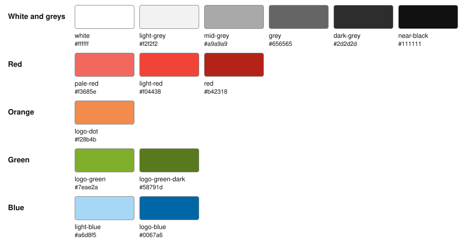

# The palette

The colours Gunnar's sites and apps share: [hilling.it](https://github.com/guhilling/hilling-it-website)
and [TaskFest](https://github.com/guhilling/ai-assisted-todolist), on the web and in the apps.
They come from the hilling.it logo.

The rules (Gunnar, 2026-11-02 and 2026-11-07):
- Use these colours. A new one is added here, and only after asking Gunnar.
- Every logo but the sites' own keeps its own colours.
- The greys are plain greys, without a tint, and there is no pure black.
- Green is the logo's. On hilling.it it stays in the logo. TaskFest uses it as its own colour, in
  `logo-green-dark` wherever it has to be read on a light background.

`palette.json` is where a colour is set. `python3 palette/generate.py` writes `palette.css` (custom
properties named `--palette-<name>`), the overview and the tables below from it, with a swatch in
`swatches/` for each colour, and CI fails when any of them is stale. The groups come from each
colour's hue, so a new colour finds its own; each group goes from light to dark.
Which colour a site uses for what, and the colours only one site needs, are each site's own
documentation: [hilling.it's](https://github.com/guhilling/hilling-it-website/blob/main/doc/colours.md)
and [TaskFest's](https://github.com/guhilling/ai-assisted-todolist/blob/main/doc/decisions/frontend.md#colours-and-faces-from-hillingits-new-site).

<!-- palette:start -->
### White and greys

| | Name | Value | For | On white | On near-black |
| --- | --- | --- | --- | --- | --- |
|  | `white` | `#ffffff` | Light backgrounds; text on the blue. | 1.0:1 | 18.9:1 |
|  | `light-grey` | `#f2f2f2` | Quiet surfaces and lines on light backgrounds; text on dark ones. | 1.1:1 | 16.9:1 |
|  | `mid-grey` | `#a9a9a9` | Secondary text on dark backgrounds. | 2.4:1 | 8.0:1 |
|  | `grey` | `#656565` | Secondary text on light backgrounds; the edge of a form field. | 5.8:1 | 3.2:1 |
|  | `dark-grey` | `#2d2d2d` | Quiet surfaces and lines on dark backgrounds. | 13.8:1 | 1.4:1 |
|  | `near-black` | `#111111` | Text on light backgrounds; dark backgrounds. There is no pure black. | 18.9:1 | 1.0:1 |

### Red

| | Name | Value | For | On white | On near-black |
| --- | --- | --- | --- | --- | --- |
|  | `pale-red` | `#f3685e` | The light red, just lighter (same hue and saturation): errors on dark grey surfaces. | 3.0:1 | 6.3:1 |
|  | `light-red` | `#f04438` | Errors on dark backgrounds. | 3.8:1 | 5.0:1 |
|  | `red` | `#b42318` | Errors on light backgrounds. | 6.6:1 | 2.9:1 |

### Orange

| | Name | Value | For | On white | On near-black |
| --- | --- | --- | --- | --- | --- |
|  | `logo-dot` | `#f28b4b` | The dot in the logo, on light backgrounds. | 2.5:1 | 7.7:1 |

### Green

| | Name | Value | For | On white | On near-black |
| --- | --- | --- | --- | --- | --- |
|  | `logo-green` | `#7eae2a` | The logo's green. On light backgrounds only as decoration: it fails contrast there. | 2.6:1 | 7.2:1 |
|  | `logo-green-dark` | `#58791d` | The logo's green, just darker (same hue and saturation): green text on light backgrounds. | 5.0:1 | 3.7:1 |

### Blue

| | Name | Value | For | On white | On near-black |
| --- | --- | --- | --- | --- | --- |
|  | `light-blue` | `#a6d8f5` | Links, accents and buttons on dark backgrounds. | 1.5:1 | 12.4:1 |
|  | `logo-blue` | `#0067a6` | The logo's blue: links, accents and buttons on light backgrounds. | 6.0:1 | 3.1:1 |
<!-- palette:end -->

Contrast is WCAG's: text needs 4.5:1 (AA), lines and shapes 3:1.

## The faces

Not colours, but shared the same way: Quicksand for the logo and the wordmarks, Space Grotesk for
headings and Inter Tight for running text, all from Google Fonts under the SIL Open Font License,
self-hosted rather than loaded from Google.
